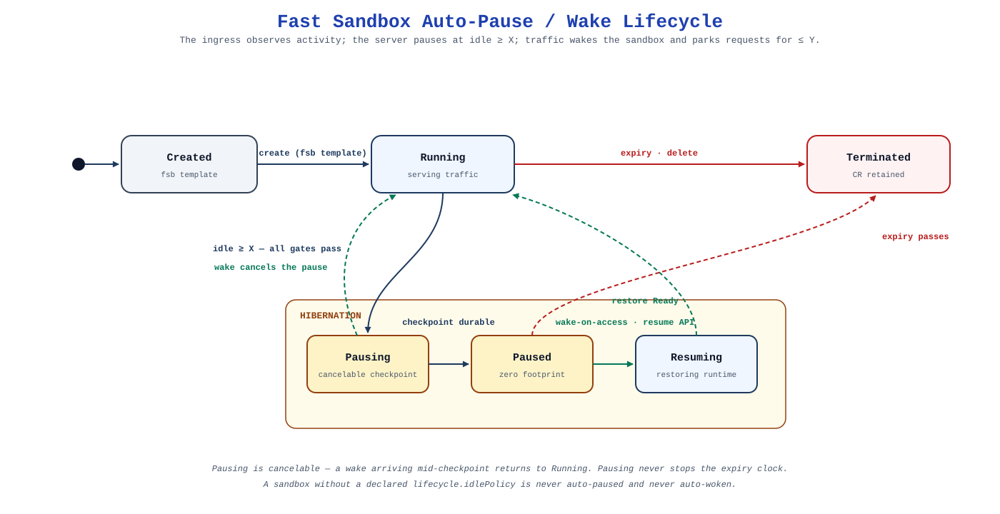
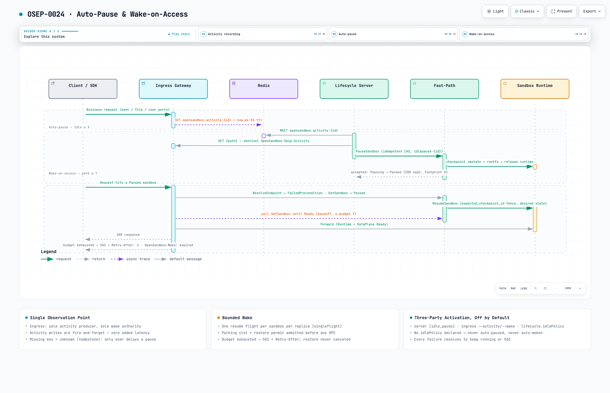

# Auto-Pause and Wake-on-Access

Fast Sandbox sandboxes occupy their full CPU and memory allocation for as long as they live, and agent workloads are idle most of that time. Auto-pause and wake-on-access turn the existing checkpoint machinery into an automatic cycle: a sandbox that opts in is paused after **X** seconds without ingress traffic, and the next request to it **wakes** it — the gateway parks the request for up to a budget **Y** while the sandbox restores, then forwards normally. Both halves default to off; scope is the fast-sandbox backend only.

Full proposal: [OSEP-0024](https://github.com/opensandbox-group/OpenSandbox/blob/main/oseps/0024-auto-pause-and-wake-on-access-for-fast-sandbox.md). Enablement and configuration: [the user guide](/guides/auto-pause-wake).

## Lifecycle

Three properties of this state machine carry most of the design:

- **Pausing is cancelable.** A wake arriving mid-checkpoint flips the sandbox back to `Running` — a wrongly-timed pause never completes.
- **Pausing does not stop the expiry clock.** A paused sandbox whose `expires_at` passes becomes `Terminated` (CR retained) and wake then fails fast with `404`.
- **Absence of policy is a hard no-op.** A sandbox that never declares `lifecycle.idlePolicy` is never auto-paused and never auto-woken, regardless of deployment flags.

## Design principles

1. **One observation point.** All client traffic transits the ingress, so it is the only activity producer and the only wake authority. What the ingress cannot see does not keep a sandbox alive; `activeProbe` is the single app-declared exception.
2. **Desired state over coordination.** `PauseSandbox` / `ResumeSandbox` are idempotent CAS patches on the Sandbox CR. Pause needs only a per-sandbox lock (checkpoints must not double-run); wake needs none — duplicate resumes converge because the restore is driven by `spec.state`, not by callers.
3. **Three-party activation.** Server config, ingress flags, and the per-sandbox policy must all agree. An unreadable or malformed policy is treated as absent — never as an implicit opt-in.
4. **Fail-safe direction.** Redis down → no pauses (wake does not use Redis). Missing activity key → *unknown*, tombstoned: data loss can delay a pause, never accelerate one. Any pause failure leaves the sandbox `Running`.
5. **Bounded wake.** One resume flight per sandbox per replica (singleflight); a parking lot and restore permits admit before any RPC; budget exhaustion answers `503 + Retry-After` and never cancels an in-flight restore.
6. **Provenance-gated replay.** The gateway-owned `OpenSandbox-Wake: expired` marker proves a request was never forwarded — only marked responses are SDK-auto-retried; post-forward re-entry retries idempotent methods once, everything else keeps today's `503`.

## How it works

👉 <a href="/architecture/network/auto-pause-wake.html" target="_blank" rel="noopener">Interactive sequence diagram</a> — walk the three phases with guided views, theme switching, and relationship tracing.

**Observe.** Every proxied request produces one activity observation: `SET opensandbox:activity:{id} = now_ms EX ttl`, a monotonic-max write issued asynchronously and coalesced per sandbox — fire-and-forget, never on the forwarding hot path. Create and resume write immediately, so the idle clock starts at the latest lifecycle transition. Since `X ≤ activity_ttl_seconds` is enforced at create time, a present-but-stale key is idle *by value*; a missing key is resolved by tombstones, not assumptions. A sandbox that declares `activeProbe` adds a pull-mode producer: when the sweeper is otherwise ready to pause, it probes the app through the gateway (sentinel-carried, never counted as activity) — a busy answer is recorded as ordinary activity, an explicit not-active lets the pause proceed, and any failure drops the candidate.

**Pause.** Each server replica sweeps every `sweep_interval_seconds`: enumerate `Running` sandboxes, batch-read activity keys, then apply the gates in order — opt-in annotation → `Running` → idle ≥ X → not expired → `NX` lock → re-verify → probe. Surviving candidates get `PauseSandbox` (idempotent CAS). There is no leader election: the lock admits one replica per idle episode and idempotency absorbs lost races, so a crashed replica leaves no stuck state. The worst case of the whole subsystem is a missed pause.

**Wake.** A request whose route resolution reports `FailedPrecondition` (or that surfaces a stale-route error) reads the sandbox state and policy; `Paused`/`Pausing`/`Resuming` start or join a resume flight. The flight — one per sandbox per replica — issues `ResumeSandbox` fenced on `expected_checkpoint_id`, parks its requests, and polls `GetSandbox` with backoff until Ready or budget Y. Parked requests hold no upstream connection; WebSocket upgrades complete after wake. Budget exhaustion answers the [wake-timeout contract](/guides/auto-pause-wake#wake-behavior-and-sdk-retry) while the restore converges in the background — the next request is served on the fast path.

## Failure behavior

| Failure | Outcome |
|---|---|
| Redis unreachable | Sweeps skipped — no pauses; wake unaffected (no Redis on that path) |
| Redis data loss | Tombstone ⇒ pause delayed by ≥ X from first observation, never accelerated |
| Replicas race to pause | Lock + idempotent CAS ⇒ exactly one pause per idle episode |
| Resume races a re-pause | `expected_checkpoint_id` fence ⇒ `Aborted`; the flight restarts within budget |
| Slow (cross-node) restore | Budget Y bounds the client; `503` + `Retry-After` while the restore continues |
| Burst to many paused sandboxes | Lot + permits bound; overflow shed before any `ResumeSandbox` |

## Security

The ingress gains exactly two FastPath calls on the channel it already holds (`GetSandbox`, `ResumeSandbox`) plus one read-only Kubernetes grant to read the idle-policy annotation. It can never pause. Parking happens after the existing host/route-scope/signature verification, so wake is reachable only for sandboxes a client can already address.

## Observability

The loop exposes wake flights, park wait durations, shed count, active restores, dropped activity writes, and probe outcomes. The **flap ratio** (pauses followed by a quick wake — the primary tuning signal for X) is derived per sandbox from pause and wake telemetry. See the [Telemetry guide](/guides/telemetry).

## References

- [User guide](/guides/auto-pause-wake) — enablement, `idlePolicy` reference, SDK retry behavior, tuning.
- [Ingress](/architecture/network/ingress) — the observation point and wake authority.
- [Fast Sandbox: Pause, Resume, and Snapshots](/architecture/fast-sandbox/checkpoints) — the checkpoint machinery this loop automates.
- [OSEP-0024](https://github.com/opensandbox-group/OpenSandbox/blob/main/oseps/0024-auto-pause-and-wake-on-access-for-fast-sandbox.md) — full proposal, alternatives, and test plan.
