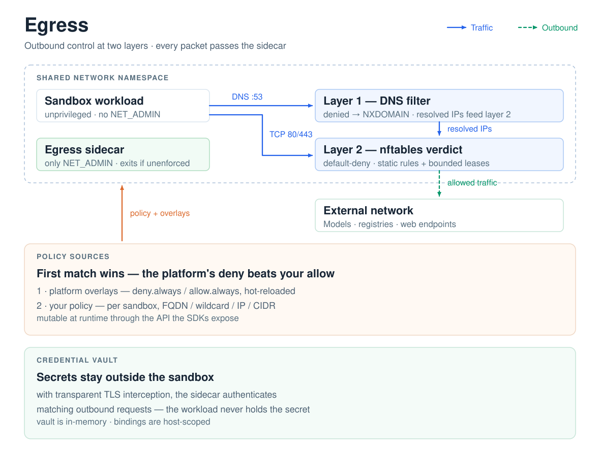

# Egress

Egress is how a sandbox gets a network policy instead of open internet access. It runs as a sidecar sharing the sandbox's network namespace, so every outbound packet passes it — no application configuration, and no way around it from inside. Policy is declared at create time (`networkPolicy`) or by the platform, and enforced continuously.

## Capabilities at a glance

| Capability | What you get |
|---|---|
| FQDN rules | Allow or deny by domain, wildcard (`*.pypi.org`), IP, or CIDR |
| DNS filtering (default) | Denied domains fail resolution; allowed ones resolve normally |
| Network enforcement (`dns+nft`) | Strict default-deny at the packet layer, fed by DNS-resolved addresses with bounded leases |
| Platform overlays | Operator-set `deny.always` / `allow.always` floors that user policy cannot override |
| Credential Vault | Secrets stay in the sidecar; credentials are injected into matching outbound requests |
| Transparent TLS interception (L7) | See, control, and authenticate outbound HTTPS — production-usable mechanism, experimental configuration surface |
| Fail-closed startup | If enforcement cannot be installed, the sidecar exits — it never runs as a no-op |

## How interception works

- **Layer 1 — DNS.** All port-53 traffic is redirected into the sidecar's DNS proxy. Denied domains answer `NXDOMAIN`; allowed domains resolve through to the real upstream, and their resolved addresses are recorded.
- **Layer 2 — Network (`dns+nft` mode).** nftables drops everything not explicitly allowed. Allowed traffic passes by static rule or via DNS-learned address sets: a resolved IP receives a bounded lease (with a grace window for active TCP connections), so "allowed" never silently becomes "allowed forever". UDP and QUIC flows rely on DNS lease timing alone.
- **Precedence.** First matching rule wins: platform `deny.always`, then platform `allow.always`, then your policy — the platform's deny always beats your allow. Overlays live inside the sidecar image and hot-reload every minute; a reload publishes only after nftables accepts the corresponding static policy. Parse or apply failures keep the last accepted in-memory rules and stay eligible for retry.
- **Runtime mutation.** Your policy is set per sandbox and can be mutated at runtime (add, replace, remove by target) through the API the SDKs expose.

## Design decisions

| Decision | Rationale |
|---|---|
| Enforcement lives in the data path | The sidecar installs redirect rules in the shared namespace; the workload holds no `NET_ADMIN`, so there is nothing to bypass and no application cooperation required. |
| Two layers, two costs | DNS filtering alone is cheap and universal but only gates names. `dns+nft` adds packet-level default-deny with DNS-learned, leased exceptions. |
| Encrypted DNS is an escape hatch | DoT (853) is always dropped, and blocking DoH over 443 is a one-switch option. |
| Fail-closed over best-effort | If redirect rules cannot be installed, the sidecar exits instead of running as silent pass-through; a supervisor restarts it with backoff and a crash-loop breaker. |
| Portable by fallback, honest about limits | Redirects install via iptables where available and fall back to native nftables (Firecracker-style guest kernels). gVisor's netstack cannot support this — Kata is the supported secure runtime — and transparent mesh sidecars conflict by construction. |

## Transparent TLS interception (L7)

Layers 1 and 2 decide *whether* a connection may happen; the transparent MITM layer adds control and visibility over *what goes through it*. When enabled, outbound HTTP and HTTPS is redirected into a mitmproxy listener inside the sidecar, which recovers the true destination from connection state and terminates TLS on the sandbox's behalf.

**Status: experimental but production-usable.** Interception, credential injection, and CA delivery are complete and run in production settings; the configuration surface — extra ports and diagnostic switches — may still change between releases.

::: warning Internal OSEP-0023 revision runtime
`OPENSANDBOX_EGRESS_EXPERIMENTAL_REVISION_RUNTIME=true` is a development-only sidecar gate (default off) for the OSEP-0023 revision protocol. It adds no public configuration surface, no `interceptionMode`, and no HTTP/2 or Fast Sandbox support; scope is bound HTTPS/443 HTTP/1.1. Key properties:

- Admission is per connection and per request, from an immutable snapshot installed over an authenticated channel; unknown or mismatched state denies — the mode never falls back to decrypt-all.
- Any uncertain outcome (unconfirmed mutation, session cleanup failure, unexpected child exit) latches a sticky recovery-required state: readiness drops, nft writes quiesce, and an independent quarantine table is installed for the process lifetime. Restarting the sidecar is not a verified recovery — destroy and recreate the sandbox instead.
- Updates are not one atomic visibility boundary: nft rules can affect traffic before receiver acknowledgement, and a committed update is not rolled back if the API response is lost. Retired connections drain within a bounded window (default 30 seconds).

Full contract, including the egress-owned policy-file storage requirements when `OPENSANDBOX_EGRESS_POLICY_FILE` is set: [credential vault guide](/guides/credential-vault#experimental-live-credential-bound-admission-osep-0023) and [OSEP-0023](https://github.com/opensandbox-group/OpenSandbox/blob/main/oseps/0023-credential-bound-tls-interception.md).
:::

**Trust is delivered, not disabled.** The sidecar exports its CA, and sandbox bootstrap installs it into the system, NSS, and JDK trust stores on a best-effort basis — clients keep certificate verification on (`curl` without `-k`). Chromium-family images should ship the native `certutil` package so the per-user NSS store can be updated.

What it enables:

- **Credential Vault** — injection happens when request headers are read, so it applies regardless of body size, including fully streamed uploads.
- **TLS-level observability** — optional request-level outcome metrics (decrypt / passthrough) for targeted diagnostic windows.

**Extendable at L7.** The bundled system addon always loads first, then any comma-separated mitmproxy addons in `OPENSANDBOX_EGRESS_MITMPROXY_SCRIPT`, in order. Addons are standard mitmproxy scripts with the full L7 hook surface (hostname, method, URI path, headers, bodies), so operators can add hostname/method/header filtering, header injection, or request rewriting as ordinary Python addons — on top of, never ahead of, the built-in behavior.

**Chained upstream proxy.** Set `OPENSANDBOX_EGRESS_UPSTREAM_PROXY` to `http(s)://host[:port]` — optionally with `OPENSANDBOX_EGRESS_UPSTREAM_PROXY_AUTH` (a complete `Proxy-Authorization` value) — to chain all mitmproxy-handled egress through that proxy via `CONNECT`:

- The endpoint accepts only `host[:port]` or a single `/` path, and the host must be a literal IP or dotted domain (a dotless name resolves differently through the pod resolver's search list, so containment sets could miss the dialed address). Credentials, query, fragment, and other paths are rejected.
- Fail-closed: flows that cannot be chained (no SNI, `ignore_hosts`/`tcp_hosts`/`udp_hosts` matches, UDP) are refused rather than sent direct. Chaining requires transparent MITM, plus `dns+nft` outside the fast-sandbox profile; invalid combinations fail startup.
- Under `dns+nft`, the proxy endpoint is reachable only from the mitmproxy process (UID-, IP-, and port-scoped nft rules), never through the sandbox allow sets. Literal proxy IPs are permanently seeded in those sets; DNS-learned ones use bounded TTLs.
- Fast-sandbox profile: the endpoint is dropped profile-wide ahead of per-subject rules, and its hostname is registered as an infrastructure domain. The shared mitmproxy queries the pod resolver and its forward upstreams concurrently and seeds permanent drop sets with the union; startup fails (previous kernel table intact) unless both succeed with a nonempty union.
- Configuration: the server's `[egress.upstream_proxy]` section on Docker and Kubernetes — see [server configuration](https://github.com/opensandbox-group/OpenSandbox/blob/main/server/configuration.md#egress) and [Chained Upstream Proxy Operations](/guides/egress-upstream-proxy). The same section can deliver an extra CA bundle (a Docker host PEM path or a Kubernetes Secret mounted read-only into the egress sidecar only) that mitmproxy trusts in addition to — never instead of — the system roots.

**Scope notes:**

- Ports 80 and 443 are always intercepted; a bounded list of extra ports can be added. Vault binding matching currently fires on 80/443 only — extra ports are decrypted and logged but not credentialed.
- IPv6 destinations are intercepted alongside IPv4 (listeners and redirect rules cover both address families).
- A not-yet-initialized proxy is visible in health: the sidecar answers `503 mitmproxy not ready` rather than passing traffic unexamined.
- An SSE body larger than ~1 MB can be truncated when the origin closes the connection with a TCP RST mid-body — standard TCP semantics, not an interception bug. See [Egress SSE Truncation](/guides/egress-sse-truncation).

## Credentials without secrets in the sandbox

With transparent TLS interception enabled, the sidecar can inject credentials into outbound requests that match a vault binding — bearer tokens, basic auth, API keys, or custom headers. The vault lives in the sidecar's memory only: the sandbox workload sees authenticated traffic but never holds the secret itself. See [Credential Vault](/guides/credential-vault).

## Where it runs

| Deployment | Shape |
|---|---|
| Docker | A separate sidecar container; the sandbox joins the sidecar's network namespace |
| Kubernetes | The sidecar is appended to the sandbox pod and holds the pod's only `NET_ADMIN` |
| Pooled sandboxes | Pre-warmed pods cannot gain a sidecar per request — put required controls in the Pool template (per-request `networkPolicy` + pool references are rejected) |
| Fast Sandbox | A shared egress process per Fastlet pod, one subject per sandbox — see [Fast Sandbox: Networking](/architecture/fast-sandbox/networking) |

## Service Mesh Compatibility

::: warning Not supported with transparent mesh sidecars
Egress is designed to be the only transparent outbound interception layer in the sandbox's network namespace. Deployments that inject a service-mesh sidecar (Istio/Envoy and similar) into the same pod are not currently supported for egress features.
:::

Both layers rewrite outbound traffic in the same namespace, so per-sandbox policy, transparent MITM, and Credential Vault cannot be relied on alongside mesh injection. Prefer excluding sandbox pods from mesh injection, or enforce outbound policy with a CNI-level mechanism. The same constraint applies to gVisor — use Kata, which provides comparable isolation and full egress support (see the [compatibility matrix](/guides/secure-container#compatibility-matrix)).

## Shutdown

On shutdown, the sidecar keeps DNS and network rules working while in-flight deliveries finish (a bounded window), then removes its network rules and flushes telemetry in the legacy path; the experimental containment owner retains ordinary rules instead. Delivery is best effort — forced termination can drop events. Docker gives the sidecar a 9-second stop budget on deletion. A supervisor restarts crashes with exponential backoff, a crash-loop breaker, and stale-redirect cleanup before a fresh start.

## Observability (OpenTelemetry)

When the platform configures an OTLP endpoint, the sidecar exports per-sandbox metrics: denied request counts, DNS query outcomes (denied-by-policy and resolver-failure are deliberately separate counters — alerting on the wrong one inverts the diagnosis), nftables update failures, and process resource usage. Cardinality is bounded: no queried domain or destination ever becomes a label. See [telemetry](/guides/telemetry#egress-sidecar) for the metric list and export configuration.
