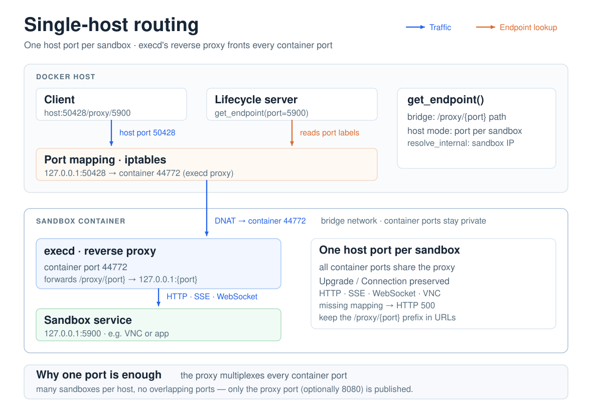

# Single-Host Network (Docker)

This page describes the **Docker runtime** on a single host. Its counterpart on Kubernetes is the [Ingress gateway](/architecture/network/ingress), which routes sandbox traffic across the cluster.

The Docker runtime exposes every sandbox port through one host port per sandbox: `execd` bundles a reverse proxy, and the runtime maps only that proxy port to the host.



## Single-host routing model
- Every sandbox container starts `execd` listening on container port `44772`. `execd` bundles a lightweight reverse proxy that intercepts requests with the `/proxy/{port}` prefix and forwards them to `127.0.0.1:{port}` inside the same container.
- The Docker runtime binds only the host side of the execd proxy port (labeled `opensandbox.io/embedding-proxy-port`). Callers use `get_endpoint(..., port=X)` to receive `{public_host}:{host_proxy_port}/proxy/{X}`, and execd transparently routes the request back to the sandbox service on port `X`.
- Because the proxy preserves `Upgrade`, `Connection`, and other HTTP headers, HTTP, Server-Sent Events, and WebSocket traffic share the same mapped host port without additional configuration.
- With this setup, a single host port per sandbox suffices to reach **all** container ports. You can safely run many sandboxes on one machine without worrying about overlapping host port allocations.
- When the caller can actually route to the sandbox's Docker network, use `get_endpoint(..., resolve_internal=True)` to bypass the host mapping and return the sandbox IP (e.g., `172.17.0.3:5900`) instead. Merely running the lifecycle server in a container is not sufficient: a server attached to a Compose network cannot normally route to sandboxes created on Docker's separate default bridge.
- The diagram above shows the routing path: host traffic hits the proxy port, execd rewrites the request towards the target container port, and upstream services remain isolated within the sandbox.

## Network modes

### Host network mode (single-host constraints)
- Containers share the host network stack (`network_mode=host`) so sandbox ports are directly accessible on the host.
- Because each sandbox binds its ports on the host, this mode practically limits you to one sandbox instance per host unless you reserve dedicated ports per sandbox.
- `get_endpoint(..., port=X)` returns `{public_host}:{X}` with no `/proxy/` prefix, so the caller needs to know the exact host port and the host must manage firewall rules for each sandbox port.

### Bridge network mode (default for single-host deployments)
- Docker places sandboxes on an isolated bridge network, preventing container ports from being reachable without explicit mapping.
- For single-host scaling, OpenSandbox maps only execd’s proxy port (`44772`) and, optionally, port `8080`. Any other container port stays private and is reached via the proxy.
- The reverse proxy label (`opensandbox.io/embedding-proxy-port`) identifies a host port that fronts `execd`. `get_endpoint(..., port=X)` returns `{public_host}:{host_proxy_port}/proxy/{X}`, so all internal ports can share the same host binding.
- Port `8080` may also receive a direct host binding (`opensandbox.io/http-port`), providing a conventional HTTP endpoint without the proxy path when required.
- This bridge setup lets a single machine host many sandboxes without port conflicts, because the same host proxy port can multiplex requests for HTTP, SSE, WebSocket, VNC, etc.

### User-mode network modes (podman: `pasta`, `slirp4netns`)
- Some container runtimes can attach a container to a user-mode network namespace instead of a bridge. Podman uses this for rootless containers, and `network_mode = "pasta"` is the practical choice on hosts where bridge networking is unavailable (for example a rootless podman machine whose netavark cannot apply its nftables ruleset).
- These modes involve **no** bridge, so no host-routable container IP exists: the Docker-compatible inspect reports an empty `NetworkSettings.IPAddress` and no `NetworkSettings.Networks` entry. The host reaches the sandbox only through the published ports.
- `get_endpoint(..., resolve_internal=True)` therefore returns the server-local host-mapped endpoint (`{proxy_host}:{host_proxy_port}/proxy/{X}`) for these modes — the same fallback used for sandboxes that share an egress sidecar network namespace — instead of failing with `NETWORK_MODE_ENDPOINT_UNAVAILABLE`.
- Everything else is unchanged: `host` / `bridge` / `none` and user-defined networks keep their existing behaviour, and `networkPolicy` (egress sidecar) still requires `bridge`.

## Containerized lifecycle server

When the lifecycle server runs on a Compose network and creates sandboxes on Docker's default bridge through the mounted Docker socket, route server-proxy traffic through the host-published ports:

```toml
[server]
host = "0.0.0.0"

[proxy]
resolve_internal = false

[docker]
network_mode = "bridge"
host_ip = "host.docker.internal"
```

The server container must resolve `host.docker.internal` to the Docker host. On Linux, add `extra_hosts: ["host.docker.internal:host-gateway"]` to its Compose service, as shown in the [Compose example](https://github.com/opensandbox-group/OpenSandbox/blob/main/server/docker-compose.example.yaml). Both HTTP and WebSocket proxy requests then use the host-mapped endpoint. A configured `[server].eip` remains the public endpoint address; the server-side proxy uses the locally reachable host instead.

::: warning Upgrade legacy server images
The legacy `server/v0.2.3` release hardcodes internal-IP resolution in both proxy paths. Setting `resolve_internal = false` alone cannot fix that release: SDK readiness checks can still time out even when the sandbox's host-mapped `/ping` endpoint responds.

Use `opensandbox/server:release-1.1.0`, which includes the configurable proxy resolution and local proxy-host fixes. OpenSandbox now uses [unified release tags](/community/versioning); the frozen `server/v*` tags do not identify newer server releases. The Compose example pins the fixed image explicitly instead of relying on `latest`.
:::

After updating the image and configuration, pull and recreate the server container. From the repository root:

```bash
docker compose -f server/docker-compose.example.yaml pull opensandbox-server
docker compose -f server/docker-compose.example.yaml up -d --force-recreate opensandbox-server
```

Retry the SDK readiness check through the server proxy after the server starts.

## Operational notes
- If execd’s proxy port (`44772`) or the optional `8080` host mapping is missing, `get_endpoint` responds with HTTP 500 and a message stating which mapping was unavailable.
- Always keep the `/proxy/{port}` prefix (including any additional path or query string) when embedding URLs in browser-based clients or SDKs so that execd can correctly dispatch the request.
- This proxy-based approach means additional ports never need to be published on the host, simplifying firewall management and improving security.
- When the lifecycle server runs in Docker with the host socket mounted, set `[proxy] resolve_internal = false`, configure `[docker] host_ip`, and make that hostname resolve to the Docker host from the server container. The repository's `server/docker-compose.example.yaml` demonstrates this topology.
