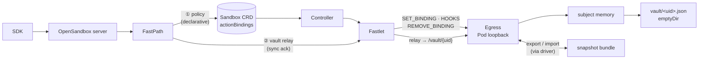
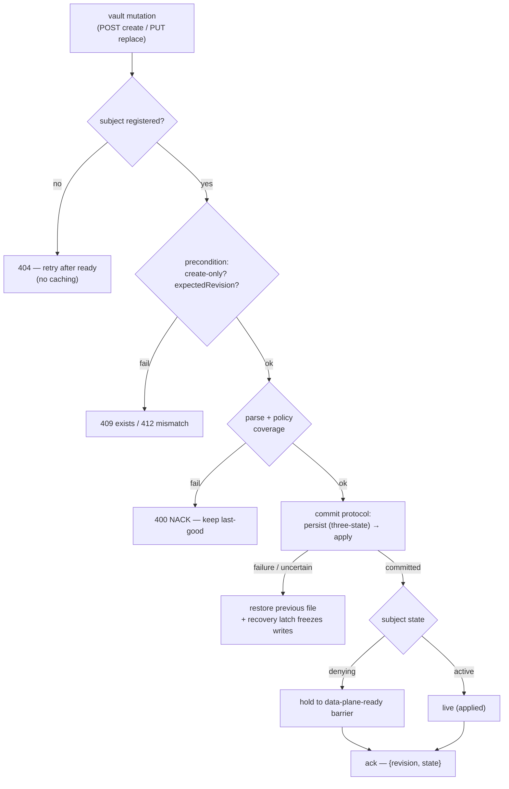
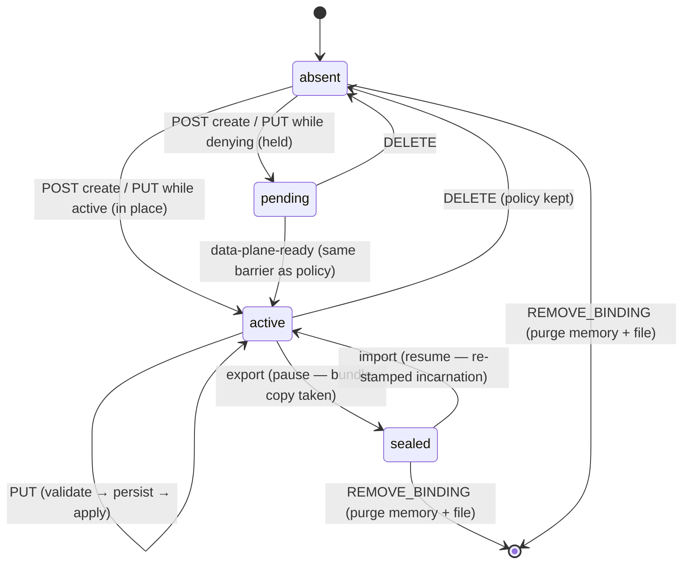
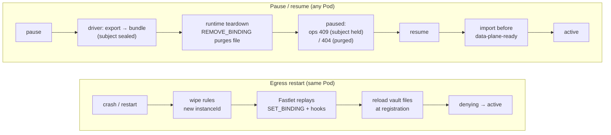
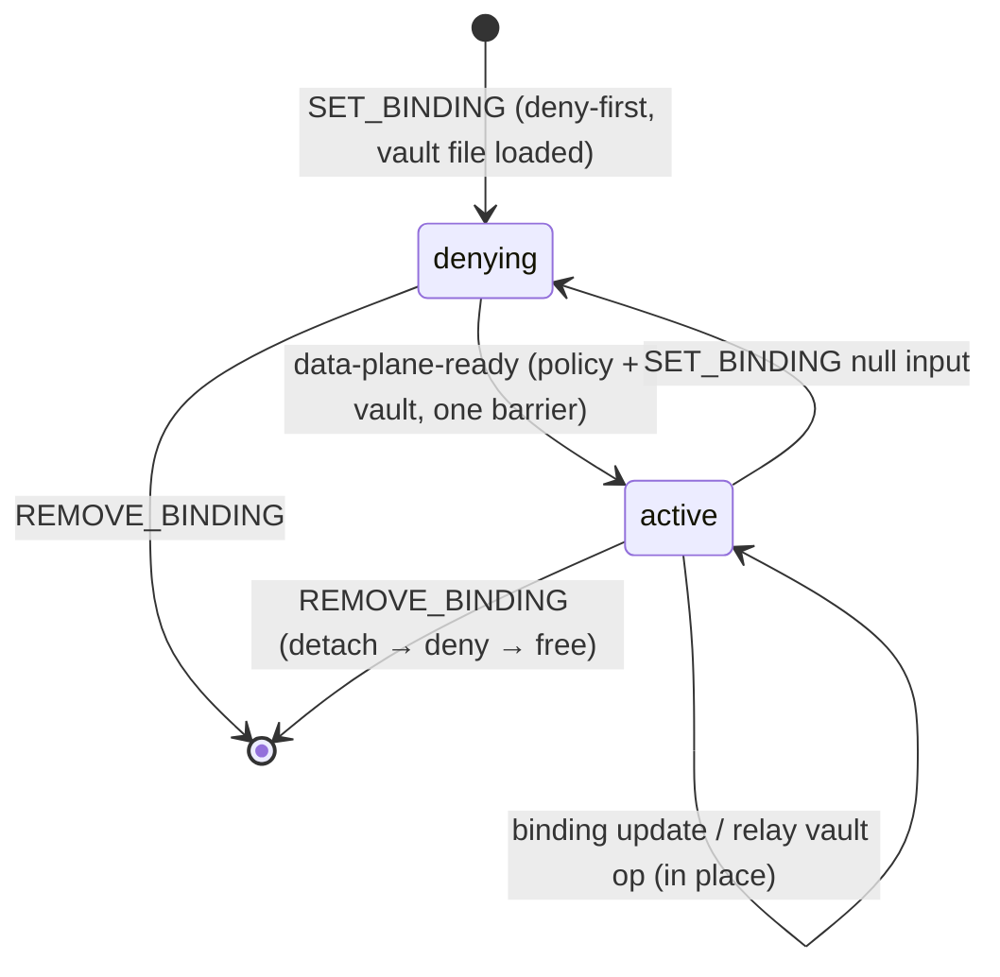
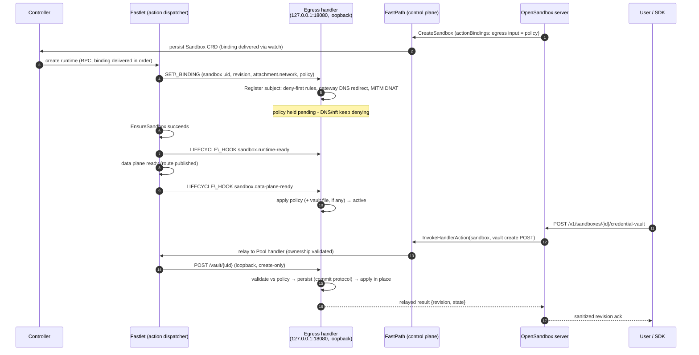
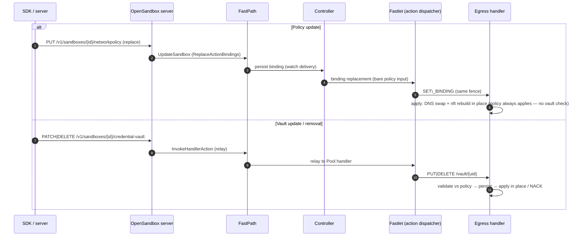

# OSEP-0022: Multi-Sandbox Egress Control Plane

<!-- toc -->
- [Summary](#summary)
- [Motivation](#motivation)
- [Goals and Non-Goals](#goals-and-non-goals)
- [Core Design](#core-design)
  - [Subject Abstraction](#subject-abstraction)
  - [Two Control Channels](#two-control-channels)
  - [Credential Vault](#credential-vault)
    - [Egress Vault Surface](#egress-vault-surface)
    - [Vault Storage](#vault-storage)
    - [Vault Lifecycle](#vault-lifecycle)
    - [Vault Sealing (deferred)](#vault-sealing-deferred)
  - [MITM Trust Anchor](#mitm-trust-anchor)
  - [Lifecycle and Fail-Closed Guarantee](#lifecycle-and-fail-closed-guarantee)
  - [Per-Subject Policy Consumption](#per-subject-policy-consumption)
  - [Sequences](#sequences)
- [System Boundaries](#system-boundaries)
  - [Profile Separation](#profile-separation)
  - [Security Boundaries](#security-boundaries)
  - [Platform Adapters](#platform-adapters)
  - [Scaling Constraints](#scaling-constraints)
- [Impact on fast-sandbox](#impact-on-fast-sandbox)
  - [Requirements on the Existing Implementation](#requirements-on-the-existing-implementation)
  - [Explicitly Untouched](#explicitly-untouched)
  - [OpenSandbox Server](#opensandbox-server)
- [Test Plan](#test-plan)
- [Drawbacks and Alternatives](#drawbacks-and-alternatives)
- [Infrastructure and Migration](#infrastructure-and-migration)
<!-- /toc -->

## Summary

A single egress control plane serves N sandboxes sharing one host/network domain (fast-sandbox Fastlet Pods, or bwrap isolated sessions). The existing single-sandbox sidecar profile is unchanged; the opt-in `fast-sandbox` profile adds a **Subject** abstraction — one opaque identifier per sandbox owning an isolated slice of policy, credentials, and kernel rules. **Policy** rides the Sandbox CRD `actionBindings` over the Fastlet's public Sandbox Actions Handler protocol (`SET_BINDING` / `LIFECYCLE_HOOK` / `REMOVE_BINDING`, `sandbox.fast.io/actions/v1`) as a bare JSON input — declarative, revisioned, replayable. The **credential vault is egress-held**: the server pushes complete vault revisions over a new generic **FastPath handler-relay RPC** (server → FastPath → Fastlet → egress loopback) and gets a synchronous, egress-validated ack; egress keeps vault state in memory plus a per-subject file (plaintext in v1 — AEAD sealing is deferred, see [Vault Sealing](#vault-sealing-deferred)), so restarts recover locally and pause/resume carries vault files in the snapshot bundle. The CRD never carries vault material; vault size is decoupled from the binding-input cap. A subject is fail-closed from `SET_BINDING` until `sandbox.data-plane-ready`, where policy and vault activate at the same barrier.

## Motivation

Egress today is a single sidecar sharing one netns with exactly one sandbox, relying on `CAP_NET_ADMIN` isolation (RFC [opensandbox-group/OpenSandbox#1582](https://github.com/opensandbox-group/OpenSandbox/issues/1582)). Two platform shapes break that model: fast-sandbox Fastlet Pods host N sandboxes with privileged guest roots (control plane must stay in the host domain), and bwrap sessions share the host netns with **no IP of their own** (source-IP dispatch impossible; host uid is the only key). Both need the same thing — *one control plane, many independent policy domains* — and the egress engines are already reusable (`pkg/nftables` has an injectable runner, `pkg/dnsproxy` a configurable listen address, `pkg/credentialvault` is in-memory); the missing piece is the policy-routing layer.

## Goals and Non-Goals

Goals:

1. **Subject abstraction**: platform-neutral identity as the unit of policy, credential, and rule ownership; dispatch key pluggable (source IP / host uid / cgroup path).
2. **Multi-sandbox dispatch**: one egress process hosts N independent subjects.
3. **Zero impact on single-sandbox mode**: sidecar profile, env, API, behavior unchanged when the `fast-sandbox` profile is off.
4. **Minimal platform surface**: the Sandbox Actions Handler protocol is consumed as-is; the only fast-sandbox asks are one generic handler-relay RPC, the fastlet relay hop, snapshot-file support, a build-time secret-mount field on SandboxTemplate (for CA baking), and deletion-path observability on the fastlet delete path (all vault/CA-agnostic except where noted). Slot release is deliberately **not** ack-gated: the fastlet delete path stays best-effort, and slot-reuse collisions are defended egress-side by stale-subject takeover (see [Lifecycle and Fail-Closed Guarantee](#lifecycle-and-fail-closed-guarantee)). The slot-store file observation is explicitly NOT used.
5. **Two concerns, two carriers, no credential persistence outside egress**: policy rides the declarative binding; vault rides the relay with egress-local persistence (memory + file) — the CRD, etcd, and backups never carry vault material. `specs/egress-api.yaml` unchanged (sidecar profile); the vault file format + relay payload are the only new OpenSandbox-owned contracts.
6. **Engine reuse**: no behavioral changes inside `pkg/dnsproxy`, `pkg/nftables`, `pkg/credentialvault`, `pkg/mitmproxy`.

Non-Goals: no per-process policies; no eBPF; no in-guest control plane; no rate limiting; no DNS-protocol changes; no policy storage on the cluster; **no credential material in the action binding** — the binding carries policy only; vault material never touches the CRD, etcd, or any binding (this supersedes both the earlier blanket rule and the sealed-binding revision; see [Credential Vault](#credential-vault)). v1 stores vault files in plaintext — an owned posture, hardened by sealing later (see [Vault Sealing](#vault-sealing-deferred)).

## Core Design

### Subject Abstraction

A **Subject** is one opaque identifier per sandbox (e.g. `s-<sandboxUID>`), owning an isolated slice of policy, credentials, and kernel rules. **Dispatch keys** are platform-provided identity material: fast-sandbox uses the sandbox source IP (from the action attachment); bwrap uses the host uid (cgroup path reserved for the future). The dispatch hot path is a pure map lookup (identity key → Subject); the registry owns the in-process state machine (absent → denying → active); the rule builder is the cold path producing per-subject kernel-rule content.

Single-sandbox mode is the process being one implicit subject (no-op layer); the `fast-sandbox` profile is N subjects. The authority over "who is who" never belongs to egress — each adapter must prove its key unforgeable (IPAM + per-sandbox netns without `NET_ADMIN`; execd-assigned uid).

### Two Control Channels

The `fast-sandbox` profile has **no sandbox-reachable control surface** (a fast-sandbox guest root is untrusted and must not rewrite its own policy or vault). One concern per channel:



| Channel | Direction | Auth | Carries |
|---------|-----------|------|---------|
| **① Sandbox Actions Handler protocol** `/_fastlet/v1/actions*` | Fastlet → egress (Pod-loopback) | loopback; envelope carries sandbox UID + revision fencing; the Fastlet is the only caller | Subject lifecycle + **policy** (bare JSON input) |
| **② FastPath handler relay** `InvokeHandlerAction(sandbox, handler, payload) → result` | server → FastPath → Fastlet → egress | FastPath validates tenant-scoped sandbox ownership — no proxy-added UID header | **Vault ops** (POST create / PUT replace / GET / DELETE, each carrying `expectedIncarnation`), synchronous result |

The listener serves the actions endpoints, `/healthz` (readiness surface for operators and pre-create probes), and the relay-only vault surface (see [Egress Vault Surface](#egress-vault-surface)). Policy never rides the relay; vault never rides the binding. Both channels terminate in one egress process — every mutation validates point-in-time and per-subject changes serialize in-process; no cross-channel fencing machinery. Slot-store file observation stays dropped; the earlier proxy-route channel is superseded (identity validation moved from a proxy header into the FastPath control plane).

#### Action envelope fields consumed

Egress reads exactly these fields from the action envelope (everything else is ignored):

| Envelope field | Used for |
|-------|----------|
| `sandbox.uid` | Subject identity (`s-<uid>`) |
| `revision.runtimeInstanceId`, `revision.attachmentId` | identity fencing (a change = rebind, discard all prior state) |
| `revision.specGeneration` | binding-update fencing |
| `attachment.network.ip` | dispatch key (`ip saddr`) |
| `attachment.network.hostVeth` | unused (on the bridge topology the IP hooks see skb->dev = the bridge, so an iifname match on the pod-side veth would never fire) |
| `attachment.network.gateway` | gateway DNS REDIRECT target / MITM DNAT target |
| `attachment.network.privateCidr` | sibling-isolation rules |
| `binding.input` | the policy (bare JSON string, parsed by egress as its policy format) |
| `hook.name` / `hook.sequence` | lifecycle checkpoint delivery order (`sandbox.runtime-ready`, `sandbox.data-plane-ready`) |

### Credential Vault

The vault is **egress-held**. In one sentence: **the server pushes complete vault revisions over the FastPath relay and gets a synchronous egress-validated ack; egress keeps the vault in memory, persists it to an egress-local per-subject file, and carries it across pause/resume as a snapshot-bundle file — the CRD never carries vault material.**

- **Why this replaced the sealed binding**: the previous revision sealed vault revisions into `actionBindings` to inherit the binding's declarative properties (ordered delivery, replay, snapshot restore) for free. That trade bought recovery at the cost of latency (every ack is a control-plane round trip through binding status), in-band error reporting (validation failures surface as async binding status, not the API response), and CRD hygiene (credential ciphertext in etcd/backups; vault size capped by the 65536-byte binding input). Egress-held state with local persistence + snapshot files re-owns that recovery machinery deliberately, and buys one-hop latency, synchronous acks, and a credential-free CRD.
- **Surfaces**: the egress loopback vault API (relay-only caller; see [Egress Vault Surface](#egress-vault-surface)); the server vault API keeps its public shape (see [OpenSandbox Server](#opensandbox-server)); the MITM addon's active-vault unix socket stays an internal egress surface. The internal relay `GET` returns the **full** revision (it is what `PATCH` merges against); the **server strips credential values on every public read**, so values never appear on any public surface.
- **Failure posture**: an operation that fails validation is **NACKed and the subject keeps its last-good state** — never half-open. A vault file that cannot be loaded at registration degrades that subject's vault (credential interception fails closed for it) while policy enforcement continues — observable on `/healthz` and the actions status payload.

The subsections below define the relay surface ([Egress Vault Surface](#egress-vault-surface)), the persistence format ([Vault Storage](#vault-storage)), and how vault state moves through the subject state machine ([Vault Lifecycle](#vault-lifecycle)).

#### Egress Vault Surface

OpenSandbox-owned endpoints on the same loopback listener, served only in the `fast-sandbox` profile; the only caller is the Fastlet's relay hop. `specs/egress-api.yaml` (the sidecar public contract) is unchanged — this surface is an internal, versioned contract between server and egress:

| Endpoint | Semantics |
|----------|-----------|
| `POST /vault/{sandboxUid}` | **Create-only** (sidecar `POST` parity): installs the initial revision; **409 when a vault already exists** (`ErrExists` semantics, atomic at egress — safe across server replicas) |
| `PUT /vault/{sandboxUid}` | Full revision replace (vault JSON + optional `expectedRevision`) → `{revision, state}`; mismatch → **412** (sidecar PreconditionFailed parity); with no vault present it creates (sidecar parity: `expectedRevision` is optional) |
| `GET /vault/{sandboxUid}` | **Full revision including values** — internal surface (relay-only, loopback); the server sanitizes all public reads |
| `DELETE /vault/{sandboxUid}` | Removes the vault; the policy is kept |



- **Commit protocol** (reuses the policy-persistence machinery — `atomicPolicyFile`): three-state mutation classification (`unchanged` — rename never attempted, safe no-op / `committed` — rename + parent-dir fsync done / `unknown` — rename attempted, durability unconfirmed), snapshot-restore of the previous file whenever an outcome is uncertain, and a recovery latch that freezes writes until reconciled. Ordering: persist → apply to live state → ack; a failed apply restores the previous file (last-good preserved); startup loads the committed file only and discards unconfirmed candidate state; an ambiguous (lost) ack resolves by readback (the OSEP-0023 pattern).
- Concurrent writers: per-subject changes serialize in-process; concurrent mutations apply one at a time and the final state is the **last-delivered** revision. `expectedRevision` makes a write conditional (stale writer → 412, recover by readback); without it the write is unconditional (last-writer-wins) — and creates the vault when none exists.
- A rejected update never leaves a partially applied revision; registration-time binding-input failures keep the fail-closed rule. A successful write clears a degraded vault (a corrupt-file subject recovers without recreation).
- `PATCH` composes server-side (relay `GET` → merge in server memory → relay `PUT`; per-sandbox in-process lock, `expectedRevision` as the cross-replica backstop); the public `POST` maps to the relay create-only op. The egress surface mirrors the sidecar contract exactly — create/409, replace/412, merge, delete. Plaintext traverses the server only transiently.

#### Vault Storage

| Aspect | Decision |
|--------|----------|
| Layout | one file per subject: `<egress-volume>/vault/<sandboxUid>.json` — purge and snapshot export are per-file ops |
| Format | `{"v": 1, "incarnation": <runtimeInstanceId>, "attachmentId": <attachmentId>, "revision": …, "vault": {…OSEP-0012 vault JSON…}}` — versioned shared server↔egress contract (conformance vectors in this repo); the full runtime fence (`incarnation` + `attachmentId`) identifies the owning instance, so a rebind that changed only the attachment can never resurrect a predecessor's file after an uncertain purge. Readers reject unknown versions without destroying the file (reserved for the newer writer) |
| v1 posture | **plaintext** (owned): the egress volume + snapshot-bundle storage join the credential trust surface (see [Security Boundaries](#security-boundaries)). Deferred hardening: AEAD-seal the same file body — file bytes only ([Vault Sealing](#vault-sealing-deferred)) |
| Commit | reuses the policy-persistence machinery: three-state classification (`unchanged`/`committed`/`unknown`), snapshot restore on uncertain outcomes, recovery latch freezing writes; the relay ack follows `committed` (acked ⇒ durable **and** applied) |
| Reload | at `SET_BINDING` (re)registration — the egress-restart recovery path; the file's recorded fence (`incarnation` + `attachmentId`) must match the envelope: match → reload (same-instance recovery), mismatch → **stale, discarded** (a reset never carries old credentials into a new sandbox); corrupt/unreadable or policy-rejected → that subject's vault degrades (interception fail-closed, policy unaffected), surfaced on the actions status payload, and the unusable file is quarantined so a restart cannot re-degrade on it |
| Purge / restore | `REMOVE_BINDING` deletes memory + file (terminal); snapshot restore imports the bundle file before `data-plane-ready` and **re-stamps it with the new `incarnation`** — the only authorized incarnation transfer |
| Volume | Pod-scoped **`emptyDir`** (FastletTemplate): survives egress container crash/restart (the reload path), dies with the Pod. Container writable layer insufficient (wiped on restart); `hostPath` rejected (ownerless plaintext on node disk after Pod recreation, no GC). Optional `medium: Memory` (tmpfs) keeps plaintext off node disk |

#### Vault Lifecycle



A vault op before registration → **404** (no caching; SDK flow is create → ready → set vault). A vault op on a **sealed** (paused) subject → **409** — a mutation would go stale: the bundle copy is already taken. A validation failure at any step → **NACK, last-good kept** — never half-open.



**Ordering invariant: export strictly precedes the runtime teardown** — `REMOVE_BINDING` purges the local file, so the bundle copy must exist first; the driver invokes export inside the pause flow, before teardown. **No server re-push exists or is needed** — egress self-persistence covers both recovery paths. A Handler without the `vaultTransfer` capability (an older build predating the vault operations, or one without vault persistence configured) makes the fastlet skip the transfer and pause without the vault: a capability gap degrades to the pre-transfer semantics instead of failing the checkpoint, and only a genuine transfer failure on a capable Handler fails it.

#### Vault Sealing (deferred)

Encrypting the vault at rest is **deferred, not v1 scope** — and deliberately **egress-local**: it changes file bytes only. No channel, surface, lifecycle, template, snapshot-manifest, or platform-contract change; no server key custody; the Secret gains additive entries. Pinned here so the design is settled when picked up:

| Aspect | Decision (when sealing lands) |
|--------|-------------------------------|
| Envelope | file body becomes `{ "v": 2, "kid", "alg": "A256GCM", "ct": base64(nonce ‖ ciphertext ‖ tag) }` — one AEAD seal over the whole v1 JSON; **AAD = `sandbox.uid`** (a transplanted ciphertext fails to open); v1/v2 dual-read, always write v2 |
| Key custody | per-pool `{kid, key}` entries in an egress Secret, read-only seed mount (pool-scoped on purpose — sealing keeps the blast radius at pool level, unlike the cluster-global CA) — **egress seals and opens; the server never holds a vault key**; cluster Secret encryption at rest (KMS envelope) becomes a prerequisite for sealed pools |
| Rotation | writes always seal under the newest `kid` (write = re-seal, eager migration); the Secret carries the last N (default 3) kids decrypt-only, so idle vaults keep opening inside the window |
| Migration | enabling = seal-key entries appear in the pool Secret; leftover v1 plaintext files re-seal lazily at reload (bounded per Pod) |
| Not covered | relay bodies (loopback, same trust domain), egress memory, the server's transient `PATCH` view — sealing protects **at rest** only (volume, snapshot bundles, backups) |
| Cross-pool restore | ciphertext binds to the pool key — restore into a different pool fails to open and lands in the existing degraded posture; unsupported unless pools share keys |

### MITM Trust Anchor

The fast-sandbox profile **pins the MITM CA**: a **cluster-global**, operator-generated keypair provisioned once — mitmdump loads it from its confdir and never generates a new one. Combined with baking the public certificate into sandbox templates at build time, there is **no per-sandbox certificate delivery, guest trust seeding, or bootstrap step** in this profile, for Firecracker or containerd alike.

- **Provisioning**: the CA keypair is **versioned and immutable** — `opensandbox-mitm-ca-<version>` Secrets (v1, v2, …) hold one keypair each; the authoritative copy lives in the OpenSandbox system namespace, and distribution into consumer namespaces is a **deployment prerequisite owned by ops — a runbook, not a controller**: native Secret mounts are namespace-local, so each namespace hosting an egress pool receives a copy of its pinned version (key + certificate) and each namespace that only builds egress-managed templates receives the certificate entry alone. Copies are created per version and never mutated in place — rotation introduces a new Secret name rather than rewriting an existing one, so there is no drift class to automate away — and a missed copy fails closed and observably (the MITM addon-down signal on `/healthz`, the template bake's fail-fast, the fingerprint check) instead of silently degrading. An automated sync controller is deliberately **deferred**: pools and template namespaces are deployment-time artifacts today, and automation becomes worth building only if dynamic per-tenant pool namespaces make manual distribution a bottleneck — the design is pinned here so it can be added later without contract change. Each pool's `FastletTemplate` mounts **one pinned version** read-only as its seed volume. Copies are verified **by content, not by name**: the template bake stamps the fingerprint of the certificate it actually installed, egress exposes its pinned seed's fingerprint on `/healthz`, and a same-named copy carrying different (but individually valid) CA material fails that comparison loudly instead of degrading into opaque guest TLS failures. At startup egress copies the pinned pair idempotently into a writable confdir under the names mitmproxy actually loads — `mitmproxy-ca.pem` (private key) + `mitmproxy-ca-cert.pem` (certificate), per the component's fixed-CA contract — mitmproxy loads a confdir CA when present and only generates when missing. The read-only seed mount keeps the Secret immutable and sidesteps Secret-defaultMode/uid concerns (mitmdump runs as a non-root user).
- **Fail-closed startup, scoped to the addon**: in the fast-sandbox profile egress never silently generates a CA. A missing or unloadable pinned CA fails the MITM addon closed — it refuses to start and the down state is surfaced on `/healthz` and the actions status payload — while the rest of egress keeps serving policy actions. Pools that never enable credential interception keep working with no CA provisioned (legacy bare-policy pools upgrade unchanged); a cluster that intends interception and lacks the CA Secret fails observably at the addon instead of bricking policy enforcement. The sidecar profile keeps today's generate-on-start behavior unchanged.
- **Template baking**: the SandboxTemplate CR carries a build-time **secret-mount field** (secret ref + mount path); the **server fills it** when creating the Template CR — it chooses which Secret entry (the **certificate only**, never the private key) and where it mounts, selecting the CA **version the template bakes**. The template builder mounts it during the same rootfs pass that bakes execd and `/etc/resolv.conf`, and installs the certificate into the guest trust store (`update-ca-certificates` or distro equivalent) together with the env vars non-system-store clients need (`NODE_EXTRA_CA_CERTS`, `REQUESTS_CA_BUNDLE`, `SSL_CERT_FILE`, `PIP_CERT`); the template records the baked CA **version and fingerprint** (annotations, stamped by the builder from the certificate it actually installed) so template↔pool pinning is checkable by content. Guests trust the interception CA from the first boot; nothing is delivered at sandbox create time. Because the CA is cluster-global, **templates stay pool-agnostic** — a template works with any pool pinned to its baked version.
- **Superseded mechanisms**: the `mitm-ca` export directory, the fastlet read-only mount of it into sandboxes, guest trust-store seeding at bootstrap, and the stale-CA purge on restart are all dropped for this profile. `SyncRootCAFastSandbox` degrades to a startup consistency check (confdir cert == pinned cert) and the export path remains sidecar-only.
- **Restart and snapshot safety**: egress restart no longer rotates the CA, so live sandboxes keep passing TLS verification across restarts, Hook replays, pause/resume, and snapshot restore (the certificate is part of the rootfs the snapshot carries). This removes a whole failure class of the ephemeral-confdir behavior, where an egress restart silently invalidated every live guest's trust anchor.
- **Observability**: the pinned CA's fingerprint is exposed on `/healthz` and mirrored in the actions status payload — with an explicit addon-down signal when no CA is provisioned — so a template↔pool Secret mispairing is visible at a glance instead of surfacing as opaque guest TLS failures. The fingerprint, not the Secret name, is the content identity: under ops-runbook distribution a same-named copy may carry different but valid CA material, which a version-string check cannot catch — the template-stamped fingerprint vs the egress-pinned fingerprint comparison is what flags it.
- **Rotation**: deliberate, cluster-wide, and **version-pinned** — create the next immutable Secret (`…-v(N+1)`) → distribute it to the consumer namespaces (ops runbook) → rebuild templates baking that version → roll pools pin by pin; an egress container always copies **its pinned version**, so a restart mid-rotation keeps signing with the CA its live guests trust, and restored snapshots (which carry their CA version) target a pod pinned to a compatible version. Old-version pods drain with their sandboxes. No automatic rotation; long horizons (10–20 years, or longer) are acceptable for a private CA. A leaked CA key is MITM capability **cluster-wide** until rotation completes — production-secret handling applies.

### Lifecycle and Fail-Closed Guarantee



The Fastlet is the only lifecycle dispatcher; egress is the Handler.

- **Register**: identity + fencing from the envelope (`sandbox.uid`, `revision`); the policy parses fully before any mutation; deny-first installs immediately — blocked until activation. A bad input is a permanent 400 — never half-registered.
- **Activate**: DNS policy swap + one atomic nft batch; the vault activates at the same barrier. `runtime-ready` only confirms the deny-first install; updates on a ready subject apply in place.
- **Unload**: `REMOVE_BINDING` is terminal (enforcement, vault memory, file); stale removals (fence mismatch) are ignored, missing state is success.
- **Races**: fence mismatch discards all prior state — a reset never carries old policy or credentials into a new sandbox. Relay vault ops validate point-in-time: unregistered subject → 404, consistency failure → NACK keeps last-good (see [Vault Lifecycle](#vault-lifecycle)).
- **Stale-subject defense (slot reuse — takeover)**: the dispatch key is the slot IP, and slots are reused. Slot release is deliberately **not** ack-gated — the fastlet delete path stays best-effort (ack-gated release was considered and rejected as too heavy a platform ask) — so a reused slot IP can meet a stale (dead-but-registered) subject whenever `REMOVE_BINDING` fails or is lost in a crash window. This is an expected case, and the defense is **egress-side takeover**: a `SET_BINDING` claiming a dispatch key held by a different live subject is authoritative that the previous owner is gone (the Fastlet is the only lifecycle authority) — egress tears down the stale subject's enforcement and vault, then registers the successor deny-first, all under the same per-subject lock. Traffic is never dispatched to the stale rules — with or without a live successor. Unloads stay fence-guarded: a late `REMOVE_BINDING` can never disturb a successor (index drops clear only mappings that still point to that subject).
- **Recovery**: egress restart → new `instanceId` → Fastlet replays binding + reached hooks → vault files reload at registration → deny → activate. No server reconciliation.

### Per-Subject Policy Consumption

```
 SubjectRegistry:  s-A→policy/vault/sets   s-B→policy/vault/sets   s-C→…
        │                │                       │
   SubjectResolver (hot path: source IP → Subject)
        │                │                       │
   DNS proxy         nft builder             mitmdump (SHARED)
   per-query policy  per-subject sets        vault by client source IP
   (w.RemoteAddr)    (deny-first)            (REDIRECT preserves source IP)
        └── resolved IPs ──► dynamic allow sets (per subject)
```

Each subject owns an isolated slice (policy, vault, kernel sets); the resolver is the only shared component (pure map lookup). The vault slice is loaded from the egress-local vault file at registration and updated in place via the relay channel. The mitmdump instance is shared in the fast-sandbox adapter; per-subject listeners are only needed where identity is not recoverable from the socket (bwrap uid mode).

### Sequences

#### Sandbox creation: binding + Hook delivery, then vault initialization



Invariant: deny-first is installed at `SET_BINDING`, before the runtime exists — Hooks can be late, never early-open. A vault mutation on a not-yet-active subject waits at the same barrier; after, it applies in place. The relay response **is** the ack: success means egress has validated, persisted (committed), and applied the revision — the server never believes credentials are in place before the subject has loaded them.

#### Runtime updates



Unload is declarative (`REMOVE_BINDING`: enforcement, vault memory, file). Vault mutations exist only on the relay; policy mutations only on the binding.

## System Boundaries

### Profile Separation

The two profiles are mutually exclusive deployment forms. `sidecar`: a service inside the sandbox network domain owning the public contract (18080, `/policy`, `/credential-vault`) — unchanged. `fast-sandbox` (`OPENSANDBOX_EGRESS_PROFILE=fast-sandbox`): a host-domain control-plane component that serves `/_fastlet/v1/actions*`, `/healthz`, and the relay-only vault surface (`/vault/{sandboxUid}`) on Pod-netns loopback; policy rides the binding; credentials are pushed by the server over the FastPath relay and persist in the egress volume (plaintext in v1).

### Security Boundaries

| Boundary | Guarantee |
|----------|-----------|
| No sandbox-reachable control surface | Listener on Pod-netns loopback only; sandbox guests cannot reach it; the Fastlet action dispatcher and the relay path are the only peers. No UID-header trust is needed — vault identity is FastPath-validated (tenant-scoped sandbox ownership); policy identity comes from the Fastlet-delivered envelope |
| Control plane outside the sandbox | Egress daemon never runs in the guest (RFC #1582 trust-boundary analysis); sandbox users run privileged and cannot touch it |
| Vault material never in the control-plane store; plaintext at rest in v1, owned | The Sandbox CRD, etcd, and backups never carry vault material. In v1 vault state persists **in plaintext** in the egress Pod volume and in snapshot-bundle files — the trust surface grows from process memory to Pod volume + snapshot storage, both of which must be access-controlled (deployment prerequisite; see [Vault Storage](#vault-storage)). Plaintext traverses the server only transiently during `PATCH` merges; no credential traffic traverses fastlet-proxy or any other proxy. AEAD sealing of the vault file (pool key, AAD = sandbox UID) is deferred, egress-local hardening — it restores ciphertext-only-at-rest without changing the channel, surfaces, or lifecycle ([Vault Sealing](#vault-sealing-deferred)) |
| Key custody | Cluster-scoped cryptographic material in v1 is the **MITM CA keypair** — versioned immutable Secrets (`opensandbox-mitm-ca-<version>`), the private key existing only in the egress containers (seed mounts of the version each pool pins); templates carry only the public certificate and record the baked version + fingerprint. Rotation is deliberate version rollover, cluster-wide. The vault seal key is deferred with vault sealing — an egress-local follow-up, non-breaking ([Vault Sealing](#vault-sealing-deferred)). Trade-off owned: one leaked CA key is MITM capability for **every pool in the cluster** |
| Fail-closed at every transition | `denying` state, atomic policy swaps, deny-first registration, data-plane-ready as the only activation signal; registration-time input failure never registers the subject; a vault op that fails validation NACKs and keeps last-good (never half-open); a vault file that fails to load at registration degrades that subject's vault — observably; a `SET_BINDING` claiming a dispatch IP held by a different live subject triggers **stale-subject takeover** (stale teardown + successor registration under one lock — traffic never reaches the stale rules) |
| Management plane independent of subject state | Policy updates ride declarative binding replacement; vault updates ride the relay — both accepted while `denying` (held to the barrier) or `active` (in place); both surfaces are loopback-only and sandbox-unreachable |
| No creation window when egress is unavailable | Deny-first is installed at `SET_BINDING`, which precedes runtime creation and the `sandbox.runtime-ready` Hook, and deny-first installation is far faster than microVM startup. The pre-create egress healthz probe (`127.0.0.1:18080/healthz`, same Pod netns, inside `EnsureSandbox`) belonged to the withdrawn OpenSandbox runtime driver; on the firecracker driver the guarantee rests on the timing argument alone — a fully deterministic guarantee (independent of timing) would require the driver to probe egress healthz and confirm the subject is registered before container creation, recorded as a known trade-off |
| Dispatch key unforgeability | IPAM + per-sandbox slot netns without `NET_ADMIN` (existing); Pod netns rp_filter strict mode — set by egress at startup — rejects forged source IPs (iifname binding is not usable on the bridge topology — the IP hooks see skb->dev = the bridge). The `NET_RAW` drop belonged to the withdrawn OpenSandbox runtime driver; on the firecracker profile guests are microVMs behind their slot netns, so no runc capability defaults are in play |
| Enforcement placement | Pod netns `hook forward` (ACCEPT policy + unmarked-drop tail; allowed traffic is marked in per-subject `hook prerouting` chains with `meta mark set 0x2`, because an explicit forward `accept` cannot pass on the `bridge-nf-call-iptables=1` Firecracker bridge topology — the frame returns to the bridge L2 path and is dropped before postrouting) plus the Pod-netns INPUT chain for intercepted MITM traffic; Kata covered via TAP (same forward surface). The earlier per-sandbox netns OUTPUT defense-in-depth layer is dropped (the action envelope does not carry the netns path; the Pod-netns layers are authoritative for both forwarded and intercepted traffic) |

### Platform Adapters

| Concern | fast-sandbox | bwrap (setpriv) |
|---------|-------------|-----------------|
| SubjectKey | source IP (from the action attachment) | host uid |
| Enforcement hook | Pod netns `hook forward` + Pod-netns INPUT chain (MITM traffic) | host netns `hook output` |
| DNS | gateway REDIRECT → shared proxy on :15353 | per-subject port REDIRECT `-m owner --uid-owner` (port = subject) |
| MITM | shared mitmdump, vault by client IP | per-subject ports |
| Lifecycle authority | Fastlet action dispatcher (`SET_BINDING` / `LIFECYCLE_HOOK` / `REMOVE_BINDING`, `sandbox.fast.io/actions/v1`) | execd session registry, same protocol pattern (TBD, detailed separately) |
| Credentials | egress-held vault — relay channel, egress-local file (this revision) | same relay/storage model over its adapter (TBD, detailed separately) |
| Endpoint | `/_fastlet/v1/actions` + `/vault/{uid}` (Fastlet-relayed, Pod loopback) | TBD (execd adapter to be detailed separately) |

### Scaling Constraints

Two scales matter independently. **Cluster-wide** there is no centralized bottleneck for policy: bindings are delivered point-to-point by each Fastlet — no watch storm, no etcd write amplification, no API-server dependency in the policy control path. Vault ops are user-initiated, sandbox-lifetime-frequency operations over the relay (a `PUT` is one consistency check + one atomic file write) — there is no reconcile loop and no recovery-driven fan-out, because egress self-persistence covers restarts and restores. **Per-Pod density** (target 64 subjects/Pod, ≤100 policy updates/s/Pod): nft dispatch is O(1) with incremental per-subject set updates; the connection-refresh loop is bucketed per subject; one shared mitmdump; DNS proxy is a stateless map lookup; `SET_BINDING` replay adds one vault-file load per subject. Policy orchestration needs no idempotent-retry machinery: a failed binding is retried by the Fastlet's dispatcher, and the sandbox simply does not become usable until the binding reports Ready. Vault ops are synchronous RPCs — a failure returns to the caller directly.

## Impact on fast-sandbox

### Requirements on the Existing Implementation

Verified against current source (`internal/runtime/containerd/driver.go` and the Sandbox Actions protocol docs):

| Requirement | Status | Notes |
|------------|--------|-------|
| Sandbox Actions Handler protocol: `GET /_fastlet/v1/actions/status` + `POST /_fastlet/v1/actions` (`SET_BINDING` / `LIFECYCLE_HOOK` / `REMOVE_BINDING`), ordered delivery, `instanceId` replay | ✅ already present | consumed as-is by egress; the handler binds the Pool-declared `targetHTTPPort` (18080) |
| `actionHandlers` / `actionBindings` in Pool/Sandbox specs | ✅ already present | egress is declared as a Handler; the input carries the bare policy (the 65536-byte input cap no longer constrains vault size — the vault is not in the binding) |
| Slot pre-provisioning: netns/veth/MASQUERADE ready before sandbox creation; network attachment (IP, gateway, veth) delivered with `SET_BINDING` before runtime creation | ✅ already present | basis of the no-creation-window guarantee. Timing note: the first `SET_BINDING` is emitted at admission, before slot acquisition, so its `attachment.network` is empty; egress rejects it and the dispatcher's at-least-once retry converges once the slot is filled. Recommended hardening: include network fields in the attachment ID (or acquire the slot before registering bindings) to make delivery deterministic |
| Deletion-path observability | ❌ new fastlet work | today `REMOVE_BINDING` is sequenced best-effort — synchronous per handler under one shared 5s deadline, always before teardown, but failure (timeout/non-2xx) never blocks or retries: state is forgotten, a terminal fence prevents re-send, and the only trace is an in-memory diagnostics entry (pull-only `SandboxDiagnostics`, lost on Fastlet restart) — **no operator log**. Required: error-level log plus a durable diagnostic on failure. Slot release is deliberately **not** gated on the handler's ack — ack-gated release was considered and rejected as too heavy a platform ask; slot reuse while a subject may still be registered is an expected case covered by the egress-side stale-subject takeover (see [Lifecycle and Fail-Closed Guarantee](#lifecycle-and-fail-closed-guarantee)) |
| Sandbox without `NET_ADMIN` (dispatch key unforgeable) | ✅ already present | spec sets no capabilities; runc defaults exclude `NET_ADMIN` |
| Sandbox without `NET_RAW` | ➖ withdrawn with the OpenSandbox runtime driver | the profile targets the existing firecracker driver as-is; microVM guests sit behind their per-sandbox slot netns and carry no runc capability defaults, so forged-source defense rests on slot isolation plus Pod netns rp_filter strict mode (see [Explicitly Untouched](#explicitly-untouched)) |
| FastPath v2 handler-relay verb: `InvokeHandlerAction(sandbox, handler, payload) → per-handler result` | ❌ new platform contract | generic and vault-agnostic — the single RPC ask to fast-sandbox; identity is FastPath-validated (tenant-scoped sandbox ownership), replacing the earlier UID-header trust argument; today's only handler-input verb is `ReplaceActionBindings` (the CRD path) |
| Fastlet relay hop to the Pool handler's loopback port | ❌ new fastlet code | forwards relay payloads to the declared handler `targetHTTPPort` and returns the handler's response as the RPC result; reuses the existing loopback delivery path |
| Snapshot manifest carries egress-owned vault files; pause/resume invoke egress export/import | ✅ delivered (fast-sandbox #118) | export is driver-invoked inside the pause flow — strictly before the runtime teardown purges the local file; import is driver-invoked before `data-plane-ready` at restore; the file follows the sandbox to any Pod. Capability-gated: the Handler advertises `vaultTransfer` on its actions status, and a Handler without it (an older build predating the vault operations, or one without vault persistence configured) makes the fastlet **skip the transfer and pause without the vault** — the pre-transfer semantics; the resumed subject's vault is then absent (fail-closed, observable, re-pushable over the relay). A capability-probe transport failure or an invocation failure on a capable Handler still fails the checkpoint, so the egress-local vault survives for the retry |
| Cluster-level MITM CA Secrets (versioned) + namespace distribution | ➖ deployment prerequisite (ops runbook, no controller) | versioned immutable Secrets (`opensandbox-mitm-ca-<version>`); the authoritative copy lives in the OpenSandbox system namespace, and ops copies the pinned version into each namespace hosting an egress pool (key + certificate) or building egress-managed templates (certificate entry only) — native Secret mounts are namespace-local. No sync controller (deliberately deferred; see [MITM Trust Anchor](#mitm-trust-anchor)) — a missed copy fails closed and observably at the addon or the template bake. Pools pin one version via their `FastletTemplate`; copies are content-verified (template-stamped fingerprint vs the egress-pinned fingerprint on `/healthz`); idempotent confdir copy at egress startup |
| MITM CA certificate baked into sandbox templates | ❌ new platform work | the SandboxTemplate CR gains a build-time secret-mount field (secret ref + mount path); the server fills it with the **certificate entry** of the pinned version, and the template builder installs it into the guest trust store plus client env vars on the same rootfs pass that bakes `/etc/resolv.conf`; the template records the baked CA version (annotation), surfaced via the CA fingerprint on `/healthz` |

The route-credential and fastlet-proxy requirements of the earlier revision remain removed — egress consumes no proxy route; the imperative channel is the FastPath relay instead.

### Explicitly Untouched

fast-sandbox CRDs, `SandboxSpec`, fastlet phases/admission/deletion paths, the data-plane reconcile loop, route-credential issuance/verification (unused by egress), `sandbox-init` supervisor, the existing containerd/firecracker runtime drivers, `specs/egress-api.yaml`, sidecar SDK vault semantics, and the server's K8s-mode egress helper (`egress_helper.py`) are untouched. The enumerated platform changes are exactly the platform requirements above (relay verb, fastlet relay hop, snapshot vault files + pause/resume hooks, deletion-path observability, SandboxTemplate secret-mount + CA baking); the fastlet-proxy additions of the earlier revision (host upstream, `X-Fast-Sandbox-Uid`, egress route parsing) stay deleted.

**Runtime driver — withdrawn** (2026-10-16): the planned OpenSandbox runtime driver — a new `internal/runtime/contract.Driver` implementation registered in the runtime factory alongside containerd/firecracker, whose container spec dropped `NET_RAW` and whose `EnsureSandbox` probed egress healthz before container creation — is **not built**. The `fast-sandbox` profile targets the **existing firecracker driver as-is**: microVM guests sit behind their per-sandbox slot netns, so the runc `NET_RAW` default never arises (the forged-source defense is slot isolation plus Pod netns rp_filter strict mode — set by egress at startup), and there is no driver-level pre-create egress healthz probe; the no-creation-window guarantee rests on the deny-first timing argument (see [Security Boundaries](#security-boundaries)), and adding the probe to the firecracker driver remains an open hardening option, not a requirement. Existing drivers stay untouched; existing Fastlet Pods without the egress component behave exactly as today.

### OpenSandbox Server

- Fast Sandbox mapping removes the phase-1a rejection of `credentialProxy`: `networkPolicy` maps into the Create request's egress binding input (as today, bare policy); the vault is **not** carried at create time — it is created and patched after creation through the server vault API over the relay.
- Server API (additive; lifecycle spec update): `POST|PATCH|DELETE /v1/sandboxes/{sandboxId}/credential-vault` — the server relays to egress: `POST` maps to the relay **create-only** op (**409 when a vault exists** — atomic at egress, safe across server replicas; sidecar `ErrExists` parity), `DELETE` 1:1; `PATCH` is a read-modify-write (relay `GET` → merge in server memory → relay `PUT`). The **relay response is the ack** — it carries the egress-validated revision and state, so the server acknowledges synchronously (no binding-status wait).
- Reads: `GET /v1/sandboxes/{sandboxId}/credential-vault` plus the sanitized metadata reads (`GET .../credential-vault/credentials[/{name}]`, `GET .../credential-vault/bindings[/{name}]`) relay to egress, which returns the **full revision** (the internal `GET` — also what `PATCH` merges against); the **server strips credential values** and returns the sanitized sidecar shapes (names, binding metadata, revision). SDK semantics are identical across profiles, and readback resolves a lost mutation ack or discovers the current `expectedRevision` (the OSEP-0023 recovery pattern).
- Plaintext credential values traverse the server only transiently during `PATCH` composition; the server holds no vault state and no vault keys in v1 (no sealing) — it is a relay + merge point.
- The server owns the CA wiring: it reads the cluster CA Secret reference from its configuration and **fills the Template CR's secret-mount field** (certificate entry + mount path) when creating egress-managed templates; egress mounts the keypair Secret per pool. Consistency is observable via the CA fingerprint on `/healthz` (see [MITM Trust Anchor](#mitm-trust-anchor)); the earlier pool-level vault key configuration is dropped with sealing (deferred).
- Policy updates ride `PUT /v1/sandboxes/{sandboxId}/networkpolicy` (complete replacement) — unchanged. Egress readiness surfaced via the platform's `InfraComponentStatus` channel (optional, non-blocking) — unchanged.

## Test Plan

- Unit: vault surface semantics (unknown subject → 404; consistency failure → 400/NACK with last-good kept; `expectedRevision` mismatch → 412; POST create-only → 409 on existing vault; PUT validates before mutating); commit protocol (three-state classification, snapshot restore on uncertain persist, recovery latch freezing writes, crash-between-persist-and-apply rolls back, staged leftovers discarded at startup); incarnation fencing (file stamped at write, registration checks `runtimeInstanceId`, mismatch discarded, snapshot import re-stamps, relay `expectedIncarnation` mismatch rejected); vault storage (atomic write, reload at `SET_BINDING` registration, corrupt file → subject registers with vault degraded and `/healthz`/status surface it, purge on `REMOVE_BINDING`, file format `v: 1` gating); server-side `PATCH` merge (relay GET → merge → PUT; values never persisted server-side); public reads sanitize (values stripped before the SDK response; the relay GET returns the full revision); successful write clears a degraded vault; relay result shapes (sync ack carries revision + state); pinned-CA confdir seeding (idempotent seed copy materializing `mitmproxy-ca.pem`/`mitmproxy-ca-cert.pem`; missing or unloadable CA fails the MITM addon closed while policy actions keep serving; sidecar generate-on-start unchanged); template bake stamps version + fingerprint annotations from the certificate it installed, and a same-named Secret carrying different (valid) CA content is flagged by the template↔egress fingerprint comparison; subject registry transitions and fail-closed invariants; action-envelope parsing/validation (unknown apiVersion/operation/Hook rejected); rule-builder determinism; dispatch (DNS per-subject, nft sets, mitm vault selection).
- fast-sandbox e2e (Kind): N sandboxes with distinct policies and vaults on one Fastlet Pod; per-subject allow/deny at DNS/nft and per-subject credential injection; sibling isolation; fail-closed create-then-configure window (deny-first from `SET_BINDING`, policy and vault only after `data-plane-ready`; vault op before ready → 404); in-place vault revision swap on a live subject with a synchronous relay ack; policy updates always apply — narrowing below a bound credential target strands the binding as an inert entry (target unreachable → never injected), visible via GET (documented divergence from the sidecar's bidirectional 400); duplicate POST → 409; concurrent POSTs across server replicas → exactly one creator; POST retry after a later PATCH → 409 (no overwrite); egress-restart recovery (new `instanceId` → replay → vault file reloaded at registration after `incarnation` match → `denying` → active, **no server re-push**); reset (same UID, new `runtimeInstanceId`) → vault file with old incarnation discarded, never reloaded; pause/resume → vault file exported into the bundle and re-imported before `data-plane-ready`, vault survives restore on the same and a different Pod; export strictly precedes teardown (`REMOVE_BINDING` purges the file, bundle copy intact); vault op on a paused (sealed) subject → 409; guest HTTPS verified against the template-baked CA across egress restart and pause/resume; CA rotation: new version Secret → runbook distribution into consumer namespaces (exercising both copy shapes: keypair into pool namespaces, certificate-only into template-build namespaces) → rebuilt templates → pool re-pin — an egress restart mid-rotation still signs with the version its guests trust, a restored snapshot with an old CA version lands on a compatible pod; distribution failure modes: a missing consumer copy fails the template bake fast / leaves the MITM addon down on `/healthz`, and a mis-copied same-named Secret (valid but wrong CA) is flagged by the template↔egress fingerprint mismatch instead of guest TLS failures; CA fingerprint on `/healthz` flags a template↔CA mismatch (baked version ≠ pinned version); `DELETE` removes credentials and keeps policy; legacy bare-policy pools keep working (including a cluster with no CA Secret: policy served, MITM addon down surfaced on `/healthz`); sandbox cannot reach any policy or vault mutation surface (loopback-only → unreachable); stale `REMOVE_BINDING` (fence mismatch) ignored; `SET_BINDING` claiming an IP held by a different live subject → stale-subject takeover (stale teardown + successor deny-first under one lock) with **real successor traffic** asserted against the successor's own policy/vault — never the stale subject's; a late `REMOVE_BINDING` after IP reuse leaves the successor's dispatch mapping intact (fence-guarded index drop); `REMOVE_BINDING` failure on the Fastlet surfaces an error-level log/diagnostic (deletion-path observability); commit protocol: crash between persist and apply rolls back to the previous file, crash between apply and ack leaves the applied revision resolvable by readback, stale staged leftovers discarded at startup.
- (Deferred with sealing: AEAD open failures, unknown-`kid` handling, tampered-ciphertext and key-rotation-window tests.)
- bwrap: per-uid dispatch with host-uid allowlist intact. Kata: policy enforced via the Pod netns forward hook.
- Compatibility: full egress suite in `sidecar` profile; `test_egress_helper.py` unchanged.
- Manual: kill mid-transition; restart storm; kill mid-vault-write (temp+rename leaves the last-good file); corrupt the egress vault volume (subjects degraded, observable, policy unaffected).

## Drawbacks and Alternatives

Drawbacks: a Pod-domain daemon is a larger trust domain than per-sandbox processes (mitigated by per-subject isolation + deny-first); usable sandboxes require the binding + Hook flow to complete (fail-closed and observable); **vault material persists in plaintext** in the egress volume and snapshot-bundle files in v1 — the trust surface grows from process memory to Pod volume + snapshot storage, both of which must be access-controlled (the deferred hardening restores ciphertext-at-rest, [Vault Sealing](#vault-sealing-deferred)); **the platform contract is no longer zero** — one generic FastPath relay verb, the fastlet relay hop, and snapshot-file support are negotiating surface with fast-sandbox; the two channels are fully decoupled — policy↔vault consistency is one-way (vault writes validate against the policy; policy updates never consult the vault), a documented divergence from the sidecar profile where the policy API rejects bidirectionally with 400; narrowing a policy strands bound credentials as inert entries (visible via GET, never injected); the sealed binding's free replay/restore recovery is replaced by egress-local persistence + snapshot files — recovery machinery is re-owned, not eliminated; the stale-subject takeover can tear down a subject whose REMOVE_BINDING was merely delayed (the Fastlet's authority is trusted); the MITM CA is **cluster-global** — a leaked CA key is MITM capability for every pool in the cluster until rotation completes, and rotation is cluster-wide (new version Secret → rebuild CA-baked templates → re-pin pools, old-version pods drain); in exchange templates stay pool-agnostic; the vault file format + relay payload are a new OpenSandbox-owned contract that must be versioned and pinned by shared conformance test vectors.

Alternatives considered: slot-store file observation (rejected — the store is a fastlet-internal implementation detail with no stability contract; superseded by the public Sandbox Actions protocol); per-subject host-side processes (kept as deployment variant); per-sandbox sidecar in the guest netns (rejected — control plane inside the trust boundary it controls is not a security control); eBPF/cgroup dispatch (deferred); an egress-specific policy carrier CRD/ConfigMap (rejected — semantic mismatch, etcd write amplification, watch storms, credential exposure, and it couples a generic component to the cluster API; the platform's own `actionBindings` carry policy declaratively without any of these costs); **vault sealed into the binding (the previous revision of this OSEP — rejected: binding-status acks are asynchronous and slower than one relay hop, validation failures surface as async status instead of the API response, vault size collides with the 65536-byte input cap, and credential ciphertext lands in the CRD/etcd/backups under a pool-key custody obligation; its free replay/restore recovery is what egress-local persistence + snapshot files re-implement)**; **credential delivery over the fastlet-proxy route (an earlier revision of this OSEP — rejected: it required three fastlet-proxy additions and a UID-header trust argument — a proxy vouching for identity; superseded by the FastPath relay, which keeps the imperative channel but moves identity validation into the platform control plane)**; vault credentials via a host-domain unix socket or Kubernetes Secret volume (rejected — a new host-local transport to secure and a kubelet sync dependency; the relay + egress-local file needs neither — Secret volumes remain the transport for egress key material, which is a different thing from vault plaintext).

## Infrastructure and Migration

- fast-sandbox: five platform asks — the **FastPath v2 handler-relay verb**, the **fastlet relay hop** to Pool handlers, **snapshot vault files** (manifest entry + pause/resume export/import hooks), the **SandboxTemplate secret-mount field + builder CA baking**, and **deletion-path observability** on the fastlet delete path. OpenSandbox-side additions: the **egress vault surface + storage** (this OSEP); CA namespace distribution is an **ops-runbook prerequisite, not a component** — no sync controller (deferred; misses fail closed on the addon-down signal and the template bake, see [MITM Trust Anchor](#mitm-trust-anchor)); the planned OpenSandbox runtime driver is **withdrawn** — the profile runs on the existing firecracker driver as-is (see [Explicitly Untouched](#explicitly-untouched)). Deployment config: egress container in Pool `FastletTemplate` (Pod-netns privileges) with a Pod-scoped `emptyDir` mount for vault files (see [Vault Storage](#vault-storage)); the MITM CA keypair lives in versioned cluster Secrets (`opensandbox-mitm-ca-<version>`) that pools pin and mount read-only; egress-managed templates bake the pinned version's public certificate at build time via the CR's secret-mount field. Clusters must still protect the CA Secrets at rest (KMS envelope plugin on Secret encryption); **snapshot-bundle storage joins the credential trust surface in v1** (plaintext vault files) — access-controlled, encrypted-at-rest snapshot storage is a deployment prerequisite for credential-enabled pools. Cross-repo dependency: the vault file format and relay payload are shared between the server (Python) and egress (Go) — keep them versioned (`v: 1`) with shared conformance test vectors in the OpenSandbox repo.
- OSEP-0012 gains a fast-sandbox-profile delta note: v1 vault state for this profile is plaintext at rest in the egress volume and snapshot files, plaintext in egress memory, and transiently in the server during merge; sidecar semantics (memory-only) are unchanged. Sealing the vault file restores ciphertext-at-rest without further surface changes.
- `sidecar` is the default profile; existing deployments upgrade with zero config change. `fast-sandbox` profile is opt-in (`OPENSANDBOX_EGRESS_PROFILE=fast-sandbox`); Fastlet Pods without the egress component behave exactly as today until an operator enables it. Rollout order: egress vault surface behind the profile feature gate (no fast-sandbox code needed) → FastPath relay verb + fastlet hop → server vault API over the relay → snapshot export/import → docs. The previously planned proxy-route rollout stages stay cancelled, and the sealed-binding rollout stages are withdrawn. Pools that never use `credentialProxy` are unaffected end to end (the bare-policy input remains the only binding shape).
